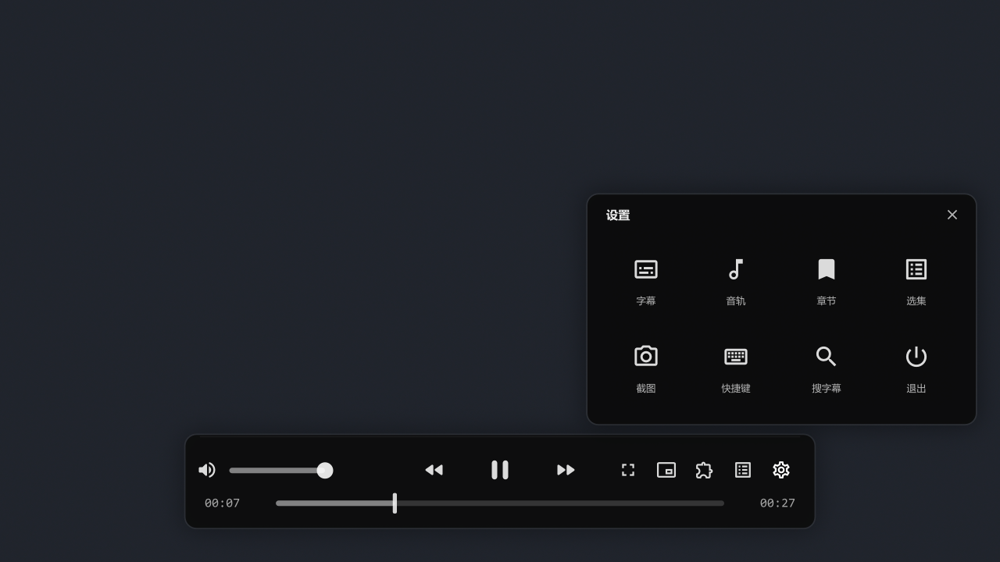

# mpv-IINA-Config

一套面向 **Windows** 的 mpv 便携配置：主界面参考 **IINA** 的 Floating OSC，
并加入中文双源字幕搜索（OpenSubtitles + Assrt）、字幕同步、自动连播等实用功能。



> 适用于 mpv 0.42+（推荐 shinchiro 的 Windows 构建）。
> 浮动控制条使用 LuaJIT FFI 调用 Windows API，因此这套 UI 主要面向 Windows。

## 功能

### IINA 风格浮动控制条

- 460 × 68 pt 圆角浮动条，底部居中，深色半透明
- 鼠标静止 2.5 秒自动隐藏（播放/暂停都一样），鼠标移动后重新出现
- 上排：音量图标 + 音量条；倍速后退 / 播放暂停 / 倍速前进；工具栏
- 下排：当前时间 / 进度条 / 总时长
- 进度条悬停显示时间提示 + thumbfast 缩略图
- 拖动进度条 / 音量条；单击视频暂停，双击全屏
- 倍速按钮每次 ±0.25x（0.25–4x），非 1x 时显示速度
- 工具栏：全屏、画中画（置顶小窗）、快捷键、选集、设置

### 紧凑的设置 / 选集弹窗

- **设置齿轮**：4×2 图标网格
  （字幕 / 音轨 / 章节 / 选集 / 截图 / 快捷键 / 搜字幕 / 退出）
- **选集按钮**：小型剧集列表
  - 短标题（`S02E01 · The Dundies`），当前集高亮
  - 滚动条 + 滚轮，点击即切换
  - 行数可通过 `playlist_rows` 调整

### 中文字幕

- `Ctrl+D`：解析文件名 → 精准查 OpenSubtitles → 没有中文时自动转 Assrt
- 支持逐集 zip、整季包、整剧包（zip/rar）
- 下载的字幕包会缓存，同季后续集秒加载
- 字幕保存为视频旁边的 `<视频名>.chs.ass/srt`，下次自动加载
- `Ctrl+Shift+D`：手动搜索菜单
- 字幕同步：`Alt+Z` 延迟 1 秒、`Alt+X` 提前 1 秒、`z/Z` ±0.1 秒
- 偏移自动保存到 `<视频名>.subs_cn.delay`；也支持整季偏移

### 其他

- 退出记忆进度、下次续播
- 自动加载同目录下一集
- 4K / HDR / 硬件解码（`gpu-next` + `d3d11va`）
- 截图、去色带、高质量缩放
- 播放结束后进入空闲窗口，不会把片尾记成续播点

## 安装

1. 下载 mpv（推荐 shinchiro 构建）：
   - https://mpv.io/installation/
   - https://github.com/shinchiro/mpv-winbuild-cmake/releases
2. 解压 mpv 到一个文件夹。
3. 把本仓库的 **`portable_config` 文件夹**复制到 `mpv.exe` 旁边。
4. 双击 `mpv.exe`，或把视频拖到 `mpv.exe` 上。

> 如果已有 `portable_config`，请先备份或改名，不要直接覆盖。

目录结构：

```text
mpv-iina-config/
├─ portable_config/
│  ├─ mpv.conf                 # 画质 / 音频 / 字幕 / 缓存
│  ├─ input.conf               # 快捷键 / 鼠标 / 滚轮
│  ├─ script-opts/             # uosc、iina_osc、subs_cn、autoload 配置
│  ├─ scripts/
│  │  ├─ iina_osc.lua          # IINA 风格浮动控制条
│  │  ├─ subs_cn.lua           # 中文双源字幕搜索
│  │  ├─ thumbfast.lua         # 进度条缩略图
│  │  ├─ autoload.lua          # 自动连播
│  │  └─ uosc/                 # uosc（菜单/播放列表/字幕菜单）
│  ├─ subs_cn/assrt_extract.ps1
│  ├─ fonts/                   # uosc 图标 + Material Icons
│  ├─ shaders/                 # 自定义着色器（空）
│  └─ subtitles/               # URL/只读目录的备用字幕目录
├─ docs/preview.png
├─ LICENSES/
├─ THIRD_PARTY_NOTICES.md
├─ LICENSE
└─ README.md
```

## 使用

### 鼠标

| 操作 | 功能 |
|---|---|
| 移动鼠标 | 显示控制条 |
| 静止 2.5 秒 | 自动隐藏控制条 |
| 单击视频 | 暂停 / 播放 |
| 双击视频 | 全屏 |
| 拖动进度条 / 音量条 | 跳转 / 调音量 |
| 右键 | uosc 菜单（字幕、音轨、章节、播放列表） |
| 滚轮在进度条上 | ±5 秒 |
| 滚轮在选集弹窗里 | 滚动列表 |
| 滚轮在视频上 | 音量 ±2 |

### 快捷键

| 键 | 功能 |
|---|---|
| 空格 / p | 播放 / 暂停 |
| ← / → | 快退 / 快进 5 秒 |
| Shift + ↑ / ↓ | 快退 / 快进 60 秒 |
| ↑ / ↓ | 音量 ±5 |
| m | 静音 |
| f | 全屏 |
| T | 窗口置顶 |
| s / S / Ctrl+S | 截图（带字幕 / 不带字幕 / 含界面） |
| [ / ] | 减速 / 加速 |
| { / } / BS | 半速 / 双速 / 恢复 1 倍 |
| v / j / J | 显示隐藏字幕 / 切换字幕 / 反向切换 |
| **Ctrl+D** | **自动搜索中文字幕（OpenSubtitles + Assrt）** |
| **Ctrl+Shift+D** | **手动搜索字幕** |
| z / Z | 字幕延迟 -0.1 / +0.1 秒 |
| **Alt+Z / Alt+X** | **字幕延迟 / 提前 1 秒（自动保存）** |
| a | 切换音轨 |
| l / L | A-B 循环 / 单文件循环 |
| < / > / Enter | 上一集 / 下一集 |
| PGUP / PGDWN | 上一章 / 下一章 |
| o | 打开文件 |
| Tab | 显示 / 隐藏控制条 |
| F1 | 快捷键帮助 |

### 设置 / 选集

- 点齿轮：打开 4×2 设置网格
- 点列表图标：打开选集列表
- 点弹窗外或再点同一个按钮：关闭
- 设置里的“字幕 / 音轨 / 章节 / 快捷键”会打开 uosc 的紧凑二级菜单

## 字幕说明

### 搜索来源

1. **OpenSubtitles**（与 IINA 同源）：带季/集/年份的精准查询
2. **Assrt（射手网）**：OpenSubtitles 没有中文时自动回退
   - 通过网页搜索 + 解析下载链接实现
   - 整剧包可能包含 `.rar` 季包，需要系统里有 **7-Zip**（`7z`）
   - 站点改版可能导致脚本失效

### OpenSubtitles 额度

仓库内置的是 **uosc 的公共 OpenSubtitles key**（不是私人密钥），
免费额度约为 **5 次下载/天**。需要更多可以换成自己的 key：

- `portable_config/script-opts/subs_cn.conf` 的 `api_key=`
- 以及 `portable_config/scripts/uosc/main.lua` 里的 `open_subtitles_api_key`

### 版权

本仓库**不包含任何字幕文件**。字幕由脚本按需下载，请遵守
OpenSubtitles / Assrt / 字幕组的版权要求，仅用于个人学习。

## 配置

主要配置文件：

| 文件 | 作用 |
|---|---|
| `portable_config/mpv.conf` | 渲染、硬解、音频、字幕、缓存、截图 |
| `portable_config/input.conf` | 快捷键、鼠标、滚轮、右键菜单 |
| `portable_config/script-opts/iina_osc.conf` | 浮动条尺寸、透明度、自动隐藏、选集行数 |
| `portable_config/script-opts/uosc.conf` | uosc 菜单紧凑化、禁用自带时间轴/控制栏 |
| `portable_config/script-opts/subs_cn.conf` | 字幕搜索 API key、语言、Assrt 开关 |
| `portable_config/script-opts/autoload.conf` | 自动连播 |

常见调整：

```conf
# iina_osc.conf
bar_width=460
bar_height=68
bottom_margin=25
autohide_timeout=2.5
background_opacity=0.88
playlist_rows=6
popover_opacity=0.94
```

更详细的中文说明见
[`portable_config/README-配置说明.md`](portable_config/README-配置说明.md)。

## 限制

- ASS 无法做真正的背景模糊；IINA 的毛玻璃只能用半透明深色近似
- 保留 Windows 原生标题栏（没有 macOS 红绿灯）
- 没有 IINA 的常驻侧栏；选集用浮动列表弹窗，字幕/音轨用紧凑菜单
- `input-builtin-dragging=no` 已关闭“按住左键拖动窗口”，否则拖进度条会带着窗口跑
- 自定义 OSC 依赖 Windows API；macOS/Linux 需要自行适配
- uosc 的 `scripts/uosc/lib/ass.lua` 有一个图标字体小改动；更新 uosc 后需要重新应用

## Credits / License

原始配置文件与脚本（`iina_osc.lua`、`subs_cn.lua`、`assrt_extract.ps1` 等）
使用 **MIT License**。

第三方组件：

- [uosc](https://github.com/tomasklaen/uosc) — LGPL-2.1
- [thumbfast](https://github.com/po5/thumbfast) — MPL-2.0
- [autoload.lua](https://github.com/mpv-player/mpv) — 来自 mpv，GPLv2+/LGPLv2.1+
- [Material Icons](https://github.com/google/material-design-icons) — Apache-2.0
- UI 设计灵感来自 [IINA](https://github.com/iina/iina)，未包含 IINA 源代码

完整的第三方声明与许可证文本见
[THIRD_PARTY_NOTICES.md](THIRD_PARTY_NOTICES.md) 和 `LICENSES/`。

---

## English summary

A Windows mpv portable configuration with an IINA-style floating OSC,
compact settings/playlist popovers, OpenSubtitles + Assrt Chinese subtitle
search, subtitle sync, thumbnails, autoload and resume playback.

Install: copy `portable_config/` next to `mpv.exe` (mpv 0.42+).

Original config/scripts are MIT; bundled third-party components keep their
own licenses (see `THIRD_PARTY_NOTICES.md`).
